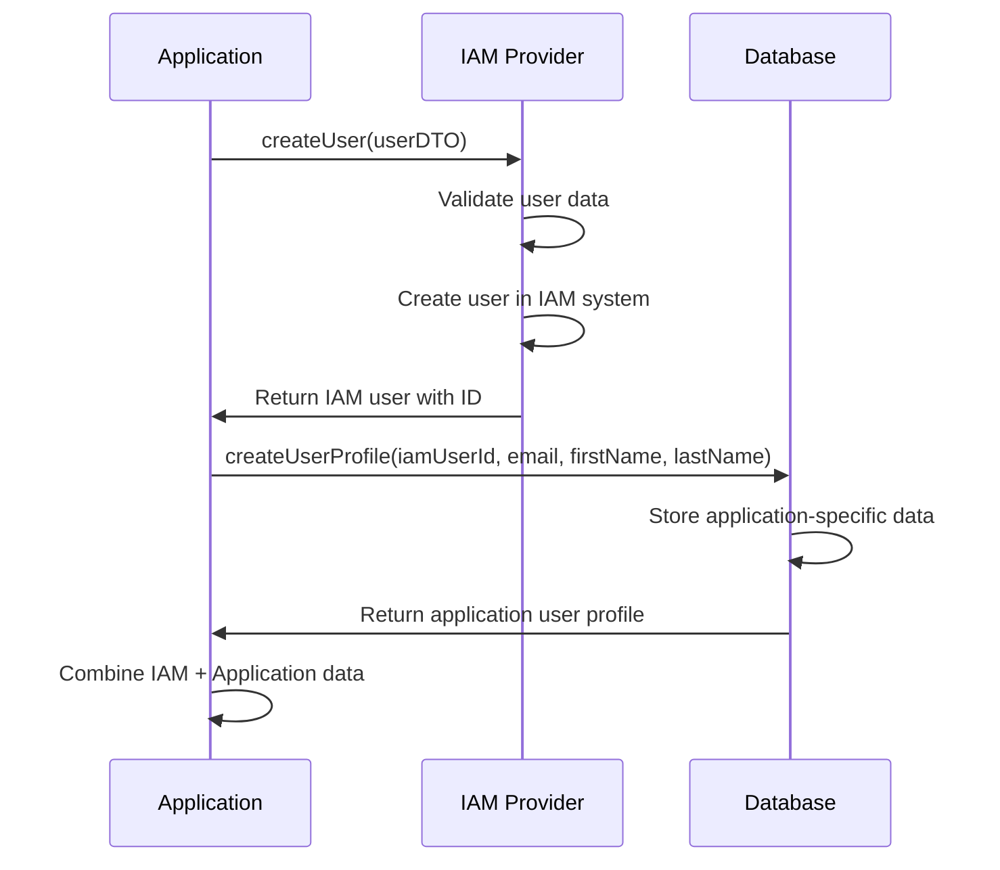
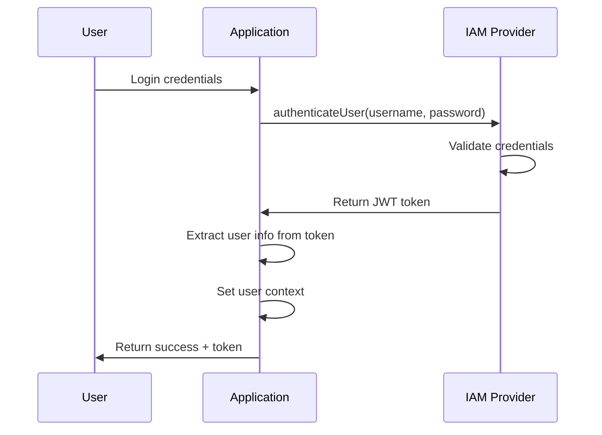

# IAM Architecture & Best Practices

## Overview

This document describes the IAM (Identity and Access Management) architecture implemented in the SaaS Starter Kit, which follows industry best practices for separating identity management from application business logic.

## 🎯 Key Principles

### 1. **Single Source of Truth for Identity**
- **IAM System**: Manages user identities, authentication, roles, and permissions
- **Application**: Only stores business-specific user data and preferences
- **No Duplication**: User identity data is never duplicated between systems

### 2. **Provider Agnostic Design**
- **Abstract Interface**: `IIAMProvider` interface abstracts all IAM operations
- **Easy Switching**: Change IAM providers through configuration (Keycloak ↔ Auth0 ↔ Okta)
- **Consistent API**: Same methods work regardless of underlying IAM system

### 3. **Clear Separation of Concerns**
- **Authentication**: Handled entirely by IAM system
- **Authorization**: Role and permission management in IAM
- **Business Logic**: Application-specific user data in database
- **User Experience**: Seamless integration between both systems

## 🏗️ Architecture Components

### Core Interfaces

```java
public interface IIAMProvider {
    // User Identity Management
    IAMUserDTO createUser(IAMUserDTO userDTO);
    IAMUserInfoDTO getUser(String userId);
    boolean deleteUser(String userId);
    
    // Authentication
    String authenticateUser(String username, String password);
    boolean validateToken(String token);
    
    // Role Management
    List<String> getRoles();
    boolean assignRoles(String userId, List<String> roles);
    
    // And many more...
}
```

### Abstract Base Class

```java
public abstract class AbstractIAMProvider implements IIAMProvider {
    // Common validation logic
    // Default implementations
    // Error handling
    // Logging utilities
}
```

### Provider Implementations

- **KeycloakProvider**: Full Keycloak integration
- **Auth0Provider**: Auth0 integration (skeleton)
- **OktaProvider**: Okta integration (can be added)
- **CustomProvider**: For custom IAM systems

## 🔄 How It Works

### User Creation Flow



### User Authentication Flow



## 📊 Data Separation

### What Stays in IAM System

| Category | Examples | Reason |
|----------|----------|---------|
| **Identity** | Username, Email, First/Last Name | Core identity data |
| **Authentication** | Password, MFA settings, Login history | Security & compliance |
| **Authorization** | Roles, Permissions, Group memberships | Access control |
| **Security** | Account status, Lockout settings | Security management |

### What Stays in Application Database

| Category | Examples | Reason |
|----------|----------|---------|
| **Preferences** | Language, Timezone, UI settings | Application-specific |
| **Business Data** | Bio, Avatar, Custom fields | Business logic |
| **Relationships** | Organization memberships, Team assignments | Application context |
| **Analytics** | Usage patterns, Feature preferences | Business intelligence |

## 🚀 Provider Switching

### Switching from Keycloak to Auth0

1. **Update Configuration**
   ```yaml
   iam:
     provider: auth0
   
   auth0:
     domain: your-tenant.auth0.com
     client-id: your-client-id
     client-secret: your-client-secret
   ```

2. **Restart Application**
   - No code changes required
   - All existing functionality continues to work
   - New users created in Auth0 instead of Keycloak

3. **Data Migration** (if needed)
   - Export users from Keycloak
   - Import to Auth0
   - Update application user profiles with new IAM user IDs

### Adding New Providers

1. **Create Provider Class**
   ```java
   @Service("customProvider")
   public class CustomProvider extends AbstractIAMProvider {
       @Override
       public String getProviderName() {
           return "custom";
       }
       
       // Implement required methods...
   }
   ```

2. **Add Configuration**
   ```yaml
   custom:
     base-url: https://your-iam.com
     client-id: your-client-id
     client-secret: your-client-secret
   ```

3. **Switch Provider**
   ```yaml
   iam:
     provider: custom
   ```

## 🔒 Security Benefits

### 1. **Reduced Attack Surface**
- No password storage in application database
- No authentication logic to exploit
- Centralized security controls

### 2. **Compliance & Auditing**
- IAM systems provide comprehensive audit logs
- Built-in compliance features (SOC2, GDPR, etc.)
- Centralized user lifecycle management

### 3. **Advanced Security Features**
- Multi-factor authentication (MFA)
- Adaptive authentication
- Risk-based access control
- Session management

## 📈 Scalability Benefits

### 1. **IAM System Scaling**
- Built for high-volume identity management
- Global distribution and CDN support
- Automatic failover and redundancy

### 2. **Application Scaling**
- No authentication bottlenecks
- Reduced database load
- Stateless authentication

### 3. **Multi-Tenant Support**
- IAM systems handle tenant isolation
- Centralized user provisioning
- Consistent security policies

## 🛠️ Implementation Details

### Database Schema Changes

#### Before (Anti-pattern)
```sql
CREATE TABLE users (
    id BIGINT PRIMARY KEY,
    username VARCHAR(50) UNIQUE,
    password VARCHAR(255),           -- ❌ Don't store passwords
    email VARCHAR(100),
    enabled BOOLEAN,                 -- ❌ Don't duplicate state
    roles TEXT[],                    -- ❌ Don't duplicate roles
    -- ... more auth fields
);
```

#### After (Best Practice)
```sql
CREATE TABLE users (
    id BIGINT PRIMARY KEY,
    keycloak_user_id VARCHAR(255) UNIQUE,  -- ✅ Reference to IAM
    email VARCHAR(100),                     -- ✅ Duplicated for convenience
    first_name VARCHAR(50),                 -- ✅ Duplicated for convenience
    last_name VARCHAR(50),                  -- ✅ Duplicated for convenience
    avatar_url TEXT,                        -- ✅ Application-specific
    bio TEXT,                               -- ✅ Application-specific
    preferences JSONB,                      -- ✅ Application-specific
    -- ... only business data
);
```

### Service Layer Changes

#### Before (Anti-pattern)
```java
@Service
public class UserService {
    public User createUser(User user) {
        // ❌ Handle authentication
        user.setPassword(encodePassword(user.getPassword()));
        
        // ❌ Handle roles
        user.setRoles(defaultRoles);
        
        // ❌ Handle user state
        user.setEnabled(true);
        
        return userRepository.save(user);
    }
}
```

#### After (Best Practice)
```java
@Service
public class UserService {
    @Autowired
    private IIAMProvider iamProvider;
    
    public IAMUserDTO createCompleteUser(IAMUserDTO iamUserDTO) {
        // ✅ Create user in IAM system
        IAMUserDTO createdIAMUser = iamProvider.createUser(iamUserDTO);
        
        // ✅ Create application profile
        User userProfile = createUserProfile(
            createdIAMUser.getUserid(),
            createdIAMUser.getEmail(),
            createdIAMUser.getFirstname(),
            createdIAMUser.getLastname()
        );
        
        return createdIAMUser;
    }
}
```

## 🔄 Migration Strategy

### Phase 1: Parallel Systems
- Keep existing user management
- Implement new IAM architecture
- Run both systems simultaneously

### Phase 2: Data Migration
- Export existing users to IAM system
- Create application profiles for migrated users
- Update references to use IAM user IDs

### Phase 3: Cutover
- Switch to IAM-based authentication
- Remove deprecated authentication code
- Clean up old database fields

### Phase 4: Cleanup
- Remove deprecated tables and fields
- Update documentation and tests
- Monitor system performance

## 📋 Best Practices Checklist

### ✅ Do's
- [ ] Delegate all authentication to IAM system
- [ ] Store only application-specific user data
- [ ] Use abstract interfaces for IAM operations
- [ ] Implement proper error handling and logging
- [ ] Validate IAM connectivity on startup
- [ ] Cache IAM responses appropriately
- [ ] Implement retry logic for IAM failures

### ❌ Don'ts
- [ ] Store passwords or authentication tokens
- [ ] Duplicate user roles or permissions
- [ ] Implement custom authentication logic
- [ ] Mix IAM and application concerns
- [ ] Hardcode IAM provider dependencies
- [ ] Skip IAM operation validation
- [ ] Ignore IAM system health checks

## 🧪 Testing

### Unit Tests
```java
@Test
public void testUserCreationWithIAM() {
    // Mock IAM provider
    when(iamProvider.createUser(any())).thenReturn(mockIAMUser);
    
    // Test user creation
    IAMUserDTO result = userService.createCompleteUser(userDTO);
    
    // Verify IAM integration
    verify(iamProvider).createUser(userDTO);
    assertNotNull(result.getUserid());
}
```

### Integration Tests
```java
@Test
public void testIAMProviderSwitching() {
    // Test with Keycloak
    userService.createCompleteUser(keycloakUser);
    
    // Switch to Auth0
    switchToAuth0();
    userService.createCompleteUser(auth0User);
    
    // Both should work identically
    assertNotNull(keycloakUser.getUserid());
    assertNotNull(auth0User.getUserid());
}
```

## 📚 Additional Resources

### Documentation
- [Keycloak Documentation](https://www.keycloak.org/documentation)
- [Auth0 Documentation](https://auth0.com/docs)
- [Okta Documentation](https://developer.okta.com/docs/)

### Standards
- [OAuth 2.0](https://oauth.net/2/)
- [OpenID Connect](https://openid.net/connect/)
- [SAML 2.0](https://docs.oasis-open.org/security/saml/Post2.0/sstc-saml-tech-overview-2.0.html)

### Security Guidelines
- [OWASP Authentication Cheat Sheet](https://cheatsheetseries.owasp.org/cheatsheets/Authentication_Cheat_Sheet.html)
- [NIST Digital Identity Guidelines](https://pages.nist.gov/800-63-3/)

## 🤝 Contributing

When contributing to the IAM architecture:

1. **Follow the Interface**: Always implement `IIAMProvider`
2. **Extend Abstract Class**: Use `AbstractIAMProvider` for common functionality
3. **Add Tests**: Include comprehensive test coverage
4. **Update Documentation**: Document provider-specific configurations
5. **Consider Migration**: Think about how existing users will be migrated

## 📞 Support

For questions or issues with the IAM architecture:

1. Check the configuration examples
2. Review the migration documentation
3. Examine the test cases
4. Create an issue with detailed information

---

**Remember**: The goal is to have a robust, scalable, and secure identity management system that can easily adapt to changing business needs while maintaining security best practices.
