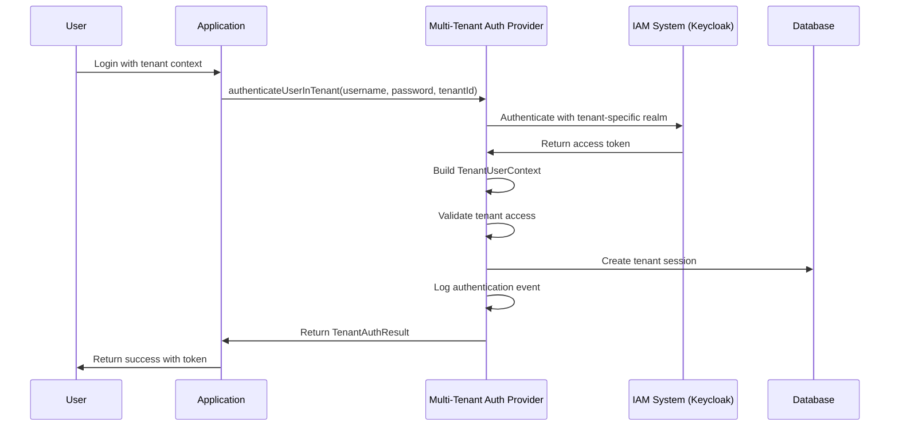
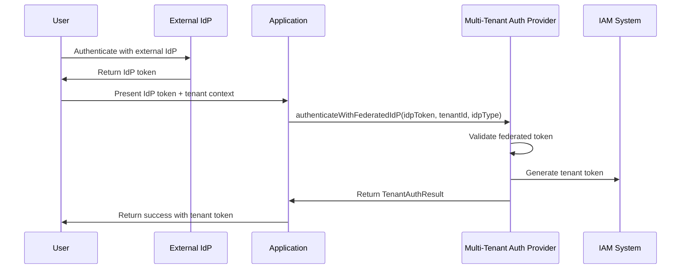
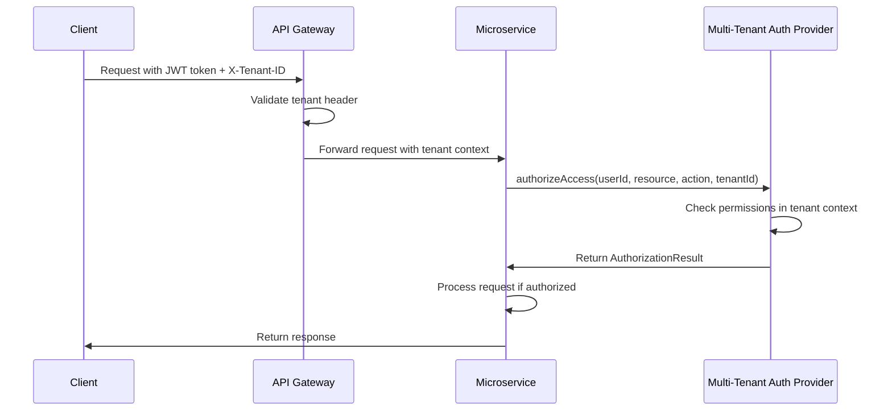

# Multi-Tenant Authentication & Authorization Architecture

## Overview

This document describes the comprehensive multi-tenant authentication and authorization system implemented in the SaaS Starter Kit. The system provides enterprise-grade security with tenant isolation, flexible authentication mechanisms, and comprehensive authorization controls.

## 🎯 Key Features

### 1. **Tenant Isolation in Auth Context**
- **Strict Tenant Boundaries**: Every authentication token, session, and identity claim includes tenant identifiers
- **Tenant-Aware Validation**: All token validation and resource access is scoped to specific tenants
- **Cross-Tenant Protection**: Prevents users from accessing resources outside their assigned tenants

### 2. **Multi-Tenant User and Role Mapping**
- **Flexible User Management**: Users can belong to multiple tenants with different roles per tenant
- **Per-Tenant Roles**: Each tenant maintains its own role hierarchy and permission structure
- **Dynamic Permission Calculation**: Effective permissions are calculated considering tenant context and user roles

### 3. **Federated and External Identity Provider Support**
- **Multi-IdP Support**: Each tenant can configure their own identity providers
- **Standards Compliance**: Full support for SAML 2.0, OpenID Connect, and OAuth2
- **Enterprise SSO Integration**: Seamless integration with enterprise identity systems

### 4. **Pluggable Authentication & Authorization Interface**
- **Provider Agnostic**: Clean abstraction layer allows easy switching between IAM providers
- **Consistent API**: Same interface works regardless of underlying provider (Keycloak, Auth0, Okta, etc.)
- **Easy Migration**: Minimal code changes required when switching providers

### 5. **Token Management and Claim Mapping**
- **Standardized Claims**: Provider-agnostic token claims for tenant ID, roles, and permissions
- **Flexible Validation**: Support for multiple token validation mechanisms
- **Token Introspection**: Comprehensive token analysis and validation

### 6. **Authorization Decision Enforcement**
- **Centralized Policy Engine**: Consistent enforcement across all services
- **ABAC Support**: Attribute-based access control for fine-grained permissions
- **RBAC Integration**: Role-based access control with tenant context

### 7. **Security Best Practices**
- **Strong Authentication**: Multi-factor authentication, password policies, and session management
- **Vulnerability Protection**: Protection against token replay, tenant impersonation, and other attacks
- **Compliance Features**: GDPR, HIPAA, and SOC2 compliance capabilities

### 8. **User and Tenant Provisioning APIs**
- **Programmatic Management**: RESTful APIs for tenant and user provisioning
- **Automation Support**: Full support for CI/CD and infrastructure automation
- **Bulk Operations**: Efficient bulk user and role management

## 🏗️ Architecture Components

### Core Interfaces

```java
public interface IMultiTenantAuthProvider extends IIAMProvider {
    // Tenant-aware authentication
    TenantAuthResult authenticateUserInTenant(String username, String password, String tenantId);
    TenantAuthResult authenticateWithFederatedIdP(String idpToken, String tenantId, String idpType);
    
    // Token management
    TenantTokenValidationResult validateTokenInTenant(String token, String tenantId);
    String generateTenantToken(TenantUserContext userContext, String tenantId);
    
    // Authorization
    AuthorizationResult authorizeAccess(String userId, String resource, String action, String tenantId);
    AuthorizationResult authorizeAccessWithAttributes(String userId, String resource, String action, 
                                                   String tenantId, Map<String, Object> attributes);
    
    // User management
    TenantUserDTO createUserInTenant(TenantUserDTO userDTO, String tenantId);
    boolean assignRolesToUserInTenant(String userId, List<String> roles, String tenantId);
    
    // Session management
    TenantSessionDTO createTenantSession(String userId, String tenantId, Map<String, Object> sessionData);
    boolean validateTenantSession(String sessionId, String tenantId);
    
    // Audit and compliance
    void logAuthEvent(String userId, String tenantId, String eventType, Map<String, Object> eventData);
    TenantComplianceReport generateTenantComplianceReport(String tenantId, String reportType);
}
```

### Tenant User Context

The `TenantUserContext` class serves as the central data structure containing all security claims and tenant information:

```java
public class TenantUserContext {
    // JWT Standard Claims
    @JsonProperty("sub") private String userId;
    @JsonProperty("iss") private String issuer;
    @JsonProperty("aud") private String audience;
    @JsonProperty("exp") private Instant expirationTime;
    
    // Tenant-specific Claims
    @JsonProperty("tid") private String tenantId;
    @JsonProperty("tname") private String tenantName;
    @JsonProperty("ttype") private String tenantType;
    
    // Role and Permission Claims
    @JsonProperty("roles") private Set<String> roles;
    @JsonProperty("permissions") private Set<String> permissions;
    
    // Security and Compliance Claims
    @JsonProperty("mfa_enabled") private Boolean mfaEnabled;
    @JsonProperty("consent_given") private Boolean consentGiven;
    @JsonProperty("data_classification") private String dataClassification;
    
    // Utility Methods
    public boolean hasRole(String role);
    public boolean hasPermission(String permission);
    public boolean isTenantAdmin();
    public boolean isSuperAdmin();
}
```

### Provider Implementations

- **KeycloakMultiTenantProvider**: Full Keycloak integration with multi-tenant support
- **Auth0MultiTenantProvider**: Auth0 integration (can be implemented)
- **OktaMultiTenantProvider**: Okta integration (can be implemented)
- **CustomMultiTenantProvider**: For custom IAM systems

## 🔄 Authentication Flow

### 1. **User Authentication in Tenant Context**



### 2. **Federated Authentication Flow**



### 3. **Token Validation and Authorization**



## 🔐 Security Implementation

### 1. **Tenant Isolation**

- **Header Validation**: All requests must include `X-Tenant-ID` header
- **Token Scoping**: JWT tokens include tenant ID in claims (`tid`)
- **Cross-Tenant Protection**: Strict validation prevents cross-tenant access
- **Workspace Separation**: Kong API Gateway uses workspaces for tenant isolation

### 2. **Authentication Mechanisms**

#### JWT Authentication
```yaml
# Kong JWT Plugin Configuration
- name: jwt
  config:
    secret: "tenant-specific-secret-${RANDOM_UUID}"
    key_claim_name: "kid"
    algorithm: "HS256,RS256"
    claims_to_verify: ["iss", "sub", "tid", "exp", "iat", "nbf"]
    anonymous: null
    run_on_preflight: false
```

#### OAuth2 Support
```yaml
# Kong OAuth2 Plugin Configuration
- name: oauth2
  config:
    scopes: ["email", "profile", "read", "write", "admin"]
    enable_authorization_code: true
    enable_client_credentials: true
    enable_implicit_grant: true
    enable_password_grant: true
    token_expiration: 7200
    refresh_token_ttl: 1209600
```

### 3. **Rate Limiting and DDoS Protection**

```yaml
# Tiered Rate Limiting
# Basic Tier: 100 requests/minute
# Standard Tier: 200 requests/minute  
# Enterprise Tier: 500 requests/minute

- name: rate-limiting
  config:
    minute: 100  # Varies by tenant tier
    hour: 1000
    day: 10000
    policy: local
    fault_tolerant: true
    hide_client_headers: false
```

### 4. **Security Headers**

```yaml
# Global Security Headers
- name: response-transformer
  config:
    add:
      headers: 
        - "X-Frame-Options:DENY"
        - "X-Content-Type-Options:nosniff"
        - "X-XSS-Protection:1; mode=block"
        - "Strict-Transport-Security:max-age=31536000; includeSubDomains"
        - "Content-Security-Policy:default-src 'self'"
        - "Permissions-Policy:geolocation=(), microphone=(), camera=()"
```

## 🚀 Implementation Guide

### 1. **Setup Multi-Tenant Auth Provider**

```java
@Service
public class MultiTenantAuthService {
    
    @Autowired
    private IMultiTenantAuthProvider authProvider;
    
    public TenantAuthResult authenticateUser(String username, String password, String tenantId) {
        return authProvider.authenticateUserInTenant(username, password, tenantId);
    }
    
    public boolean authorizeAccess(String userId, String resource, String action, String tenantId) {
        AuthorizationResult result = authProvider.authorizeAccess(userId, resource, action, tenantId);
        return result.isAuthorized();
    }
}
```

### 2. **Configure Tenant IDP Settings**

```java
TenantIdPConfig idpConfig = TenantIdPConfig.builder()
    .tenantId("tenant-a")
    .idpType("keycloak")
    .realm("tenant-a-realm")
    .clientId("tenant-a-client")
    .clientSecret("tenant-a-secret")
    .issuerUrl("https://keycloak.example.com/auth/realms/tenant-a-realm")
    .build();

authProvider.configureTenantIdP("tenant-a", idpConfig);
```

### 3. **Implement Tenant-Aware Controllers**

```java
@RestController
@RequestMapping("/api/users")
public class UserController {
    
    @Autowired
    private MultiTenantAuthService authService;
    
    @GetMapping("/{userId}")
    public ResponseEntity<UserDTO> getUser(
            @PathVariable String userId,
            @RequestHeader("X-Tenant-ID") String tenantId,
            @RequestHeader("Authorization") String token) {
        
        // Extract user ID from token
        String requestingUserId = extractUserIdFromToken(token);
        
        // Authorize access
        if (!authService.authorizeAccess(requestingUserId, "users", "read", tenantId)) {
            return ResponseEntity.status(HttpStatus.FORBIDDEN).build();
        }
        
        // Process request
        UserDTO user = userService.getUser(userId, tenantId);
        return ResponseEntity.ok(user);
    }
}
```

### 4. **Configure Kong API Gateway**

```bash
# Create tenant workspaces
kong workspace create tenant-a
kong workspace create tenant-b
kong workspace create tenant-c

# Apply tenant-specific configurations
kong workspace set tenant-a
kong config db_import kong-tenant-a.yml

kong workspace set tenant-b
kong config db_import kong-tenant-b.yml

kong workspace set tenant-c
kong config db_import kong-tenant-c.yml
```

## 📊 Monitoring and Compliance

### 1. **Audit Logging**

```java
// Log authentication events
authProvider.logAuthEvent(userId, tenantId, "LOGIN_SUCCESS", Map.of(
    "username", username,
    "ip_address", ipAddress,
    "user_agent", userAgent,
    "session_id", sessionId
));

// Log authorization events
authProvider.logAuthEvent(userId, tenantId, "ACCESS_GRANTED", Map.of(
    "resource", resource,
    "action", action,
    "timestamp", Instant.now()
));
```

### 2. **Compliance Reporting**

```java
// Generate GDPR compliance report
TenantComplianceReport gdprReport = authProvider.generateTenantComplianceReport(
    tenantId, "GDPR"
);

// Generate HIPAA compliance report
TenantComplianceReport hipaaReport = authProvider.generateTenantComplianceReport(
    tenantId, "HIPAA"
);
```

### 3. **Metrics and Monitoring**

```yaml
# Prometheus Metrics
- name: prometheus
  config:
    status_codes: true
    latency: true
    bandwidth: true
    upstream_health: true
```

## 🔧 Configuration Examples

### 1. **Application Properties**

```yaml
# application-multi-tenant.yml
multi-tenant:
  auth:
    provider: keycloak
    default-tenant: default
    session-timeout: 3600
    token-expiration: 7200
    
  keycloak:
    auth-server-url: ${KEYCLOAK_AUTH_SERVER_URL:http://localhost:8080/auth}
    realm: ${KEYCLOAK_REALM:saas-starter-kit}
    resource: ${KEYCLOAK_CLIENT_ID:saas-client}
    credentials:
      secret: ${KEYCLOAK_CLIENT_SECRET:client-secret}
    
  security:
    jwt:
      secret: ${JWT_SECRET:jwt-secret-key}
      algorithm: HS256
      expiration: 7200
      
    rate-limiting:
      basic-tier: 100
      standard-tier: 200
      enterprise-tier: 500
```

### 2. **Kong Configuration**

```yaml
# kong-multi-tenant.yml
_format_version: "3.0"

services:
  - name: tenant-a-user-service
    url: http://host.docker.internal:8081
    routes:
      - name: tenant-a-user-routes
        paths: ["/tenant-a/api/users"]
        strip_path: true
        headers:
          X-Tenant-ID: ["tenant-a"]
    plugins:
      - name: jwt
        config:
          secret: "tenant-a-jwt-secret"
          claims_to_verify: ["iss", "sub", "tid", "exp", "iat"]
      
      - name: rate-limiting
        config:
          minute: 100
          hour: 1000
          day: 10000
```

## 🚨 Security Best Practices

### 1. **Token Security**

- **Unique Secrets**: Use different JWT secrets for each tenant
- **Regular Rotation**: Rotate secrets on a regular basis
- **Algorithm Selection**: Use strong algorithms (HS256, RS256)
- **Claim Validation**: Validate all required claims including tenant ID

### 2. **Tenant Isolation**

- **Header Validation**: Always validate X-Tenant-ID header
- **Cross-Tenant Checks**: Prevent access across tenant boundaries
- **Data Segregation**: Ensure data is properly isolated between tenants
- **Workspace Separation**: Use Kong workspaces for complete isolation

### 3. **Rate Limiting**

- **Tiered Limits**: Different limits for different tenant tiers
- **Burst Protection**: Protect against sudden traffic spikes
- **IP-based Limits**: Consider IP-based rate limiting for additional security
- **Monitoring**: Monitor rate limit violations for security threats

### 4. **Audit and Compliance**

- **Comprehensive Logging**: Log all authentication and authorization events
- **Data Retention**: Implement appropriate data retention policies
- **Compliance Reports**: Generate regular compliance reports
- **Incident Response**: Have procedures for security incident response

## 🔍 Troubleshooting

### Common Issues

1. **Missing Tenant ID Header**
   - Ensure all requests include `X-Tenant-ID` header
   - Check Kong configuration for tenant validation

2. **Token Validation Failures**
   - Verify JWT secret configuration
   - Check token expiration and claims
   - Ensure tenant ID in token matches header

3. **Cross-Tenant Access Attempts**
   - Review authorization logic
   - Check tenant isolation configuration
   - Verify user-tenant mappings

4. **Rate Limiting Issues**
   - Check tenant tier configuration
   - Verify rate limit settings
   - Monitor for abuse patterns

### Debugging

```java
// Enable debug logging
logging.level.com.saasstarterkit.user.service.adapters.keycloak=DEBUG
logging.level.com.saasstarterkit.user.security=DEBUG

// Check tenant context
TenantUserContext context = authProvider.getCurrentUserInTenant(token, tenantId);
log.info("User context: {}", context);

// Validate authorization
AuthorizationResult result = authProvider.authorizeAccess(userId, resource, action, tenantId);
log.info("Authorization result: {}", result);
```

## 📚 Additional Resources

- [IAM Architecture Documentation](IAM_ARCHITECTURE.md)
- [API Documentation](API.md)
- [Security Best Practices](SECURITY_BEST_PRACTICES.md)
- [Compliance Guidelines](COMPLIANCE_GUIDELINES.md)

## 🤝 Contributing

This architecture is designed to be extensible and maintainable. When contributing:

1. **Follow Interface Contracts**: Implement all required interface methods
2. **Maintain Tenant Isolation**: Never allow cross-tenant access
3. **Add Comprehensive Tests**: Include unit and integration tests
4. **Update Documentation**: Keep this document current with changes
5. **Security Review**: All changes must undergo security review

---

*This document is maintained by the SaaS Starter Kit Team. For questions or contributions, please contact the team.*
